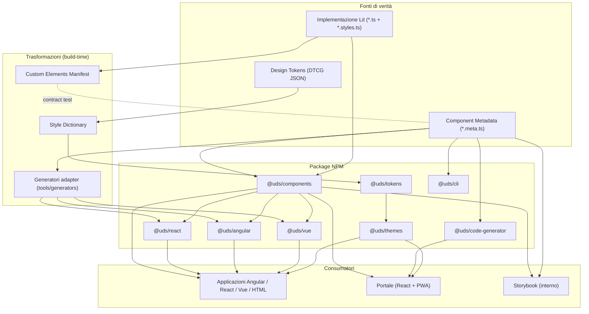

# Universal DS — Architettura

> Stato: **APPROVATA dal proprietario del progetto il 2026-11-11 (Milestone 0).**
> Ultimo aggiornamento: 2026-11-11.
> Le decisioni vincolanti sono registrate in `docs/decisions/` (ADR). In caso di conflitto prevale l'ADR più recente con stato `Accepted`.

Principio guida: **ONE DESIGN SYSTEM. ONE SOURCE OF TRUTH. MULTIPLE FRAMEWORKS.**

---

## 1. Obiettivi architetturali

| Obiettivo                                       | Come viene garantito                                                                                           | Verifica                                                                                                 |
| ----------------------------------------------- | -------------------------------------------------------------------------------------------------------------- | -------------------------------------------------------------------------------------------------------- |
| Un'unica implementazione grafica                | Componenti Lit in `@uds/components`; gli adapter non contengono markup né stili                                | Regola Nx `enforce-module-boundaries` + review: gli adapter non possono importare `lit` per il rendering |
| Una sola fonte di verità del contratto pubblico | Metadata colocati per componente (`*.meta.ts`), da cui derivano tipi, enum, controlli, documentazione, snippet | Contract test: Custom Elements Manifest estratto dal sorgente ≡ metadata                                 |
| Core indipendente dai framework                 | `core`/`components` non dipendono da React/Angular/Vue                                                         | Tag Nx + controllo dipendenze in CI                                                                      |
| Accessibilità WCAG 2.2 AA                       | Requisito di progetto per ogni componente (checklist + test automatici + test manuali)                         | Quality gate axe-core + checklist manuale firmata                                                        |
| Tree shaking e caricamento selettivo            | ESM non bundlato, un entry point per componente, `sideEffects` dichiarati                                      | `size-limit` con budget per entry point                                                                  |
| Evoluzione controllata                          | Changesets, SemVer, deprecation policy, regressione visiva                                                     | Gate di release                                                                                          |

---

## 2. Vista d'insieme



---

## 3. Struttura definitiva del monorepo

Scope npm: **`@uds`**. Prefisso dei custom element: **`uds-`** (decisione D-01).

```text
universal-ds/
├── apps/
│   ├── portal/                 # React + Vite + React Router + PWA. Ospita catalogo, docs, playground,
│   │                           # token viewer, theme builder, icon library, accessibility center, changelog
│   ├── storybook/              # Storybook interno: sviluppo isolato + base per la regressione visiva
│   └── demos/
│       ├── vanilla/            # HTML + ESM, nessun framework
│       ├── react/              # React 19 + Vite
│       ├── angular/            # Angular 22 standalone
│       ├── vue/                # Vue 3 + Vite
│       └── ssr/                # (M10) verifica SSR / Declarative Shadow DOM
│
├── packages/
│   ├── tokens/                 # Sorgenti DTCG + build Style Dictionary → CSS vars, JSON, TS
│   ├── themes/                 # Temi (light, dark, high-contrast, brand) + theme runtime manager
│   ├── core/                   # Base class Lit, registrazione sicura, controller, utilità SSR-safe
│   ├── icons/                  # Icon Registry, <uds-icon>, sanitizzazione SVG, set di icone proprietario
│   ├── metadata/               # Schema (Zod), tipi, validazione e API del registry. Nessuna definizione di componente
│   ├── components/             # Componenti Lit + i loro metadata colocati (*.meta.ts)
│   ├── react/                  # Wrapper generati (@lit/react) + tipizzazioni JSX
│   ├── angular/                # Direttive/componenti standalone generati, tipizzati (ng-packagr)
│   ├── vue/                    # Plugin, helper compilerOptions, tipizzazioni GlobalComponents
│   ├── code-generator/         # Motore puro TS: configurazione → codice HTML/React/Angular/Vue
│   ├── theme-tools/            # (M7) validazione temi, contrasto, diff, export CSS/JSON
│   ├── builder-engine/         # (M8) modello di composizione, comandi, undo/redo — headless
│   ├── cli/                    # init, add, list, doctor
│   └── testing/                # Utilità di test condivise (privato, non pubblicato)
│
├── tools/
│   ├── generators/             # Plugin Nx locale: scaffold componente, generazione adapter
│   ├── lint/                   # Regole ESLint/Stylelint custom (es. divieto di valori grafici hard-coded)
│   ├── scripts/                # Contract check metadata↔CEM, report bundle size, verifiche package
│   └── build/                  # tsconfig base, preset Vite/Vitest condivisi
│
├── docs/
│   ├── architecture/           # Approfondimenti (dependency graph, metadata, testing, governance, requisiti)
│   ├── accessibility/          # Standard, checklist per componente, protocolli di test manuale
│   ├── development/            # Guide operative (setup, nuovo componente, release)
│   ├── decisions/              # ADR
│   ├── standards/              # Convenzioni di codice, naming, API dei componenti
│   └── milestones/             # Report di fine milestone
│
├── .changeset/
├── .github/workflows/
├── MASTER_PLAN.md
├── ARCHITECTURE.md
├── CONTRIBUTING.md             # (M1)
├── README.md                   # (M1)
├── pnpm-workspace.yaml         # (M1)
├── nx.json                     # (M1)
└── package.json                # (M1)
```

### Differenze rispetto alla struttura di riferimento della specifica

| Specifica                                                    | Proposta                                          | Motivazione                                                                                                                                                                                                                                                         |
| ------------------------------------------------------------ | ------------------------------------------------- | ------------------------------------------------------------------------------------------------------------------------------------------------------------------------------------------------------------------------------------------------------------------- |
| `apps/documentation`, `apps/playground` separati dal portale | Consolidati in `apps/portal`                      | La specifica (§13) colloca documentazione e playground dentro il portale. Tre app distinte duplicherebbero navigazione, temi, routing e PWA. La logica riutilizzabile vive nei package headless (`code-generator`, `builder-engine`, `theme-tools`). Vedi ADR-0007. |
| `apps/demo/*`                                                | `apps/demos/*` + `apps/demos/ssr`                 | Le demo sono app indipendenti con i propri build; si aggiunge la demo SSR richiesta da §11.                                                                                                                                                                         |
| —                                                            | `apps/storybook`                                  | Storybook è richiesto (§4) ma non era collocato nella struttura.                                                                                                                                                                                                    |
| —                                                            | `packages/theme-tools`, `packages/builder-engine` | §14 e §16 chiedono di separare motore e UI: la logica non deve vivere nel portale.                                                                                                                                                                                  |
| `tools/build`                                                | + `tools/lint`                                    | Le regole che vietano valori grafici arbitrari (§7.4) richiedono regole lint custom.                                                                                                                                                                                |

---

## 4. Package e responsabilità

| Package                    | Responsabilità                                                                                                                                                                            | NON deve                                      | Pubblicato   | Build                        |
| -------------------------- | ----------------------------------------------------------------------------------------------------------------------------------------------------------------------------------------- | --------------------------------------------- | ------------ | ---------------------------- |
| `@uds/tokens`              | Sorgenti DTCG; output CSS custom properties, JSON risolto, costanti TS dei nomi delle variabili                                                                                           | Contenere logica runtime                      | Sì           | Style Dictionary             |
| `@uds/themes`              | Temi come override di token semantici; CSS per tema; `ThemeManager` (applica, cambia a runtime, persiste se richiesto)                                                                    | Definire token primitivi nuovi                | Sì           | Style Dictionary + tsc       |
| `@uds/core`                | `UdsElement` (base Lit), `defineElement` idempotente, controller (form association, focus), emissione eventi tipizzati, stili base (focus ring, reduced motion, forced colors), guard SSR | Contenere componenti UI                       | Sì           | tsc                          |
| `@uds/icons`               | Icon Registry, `<uds-icon>`, sanitizzazione SVG, set proprietario ottimizzato (SVGO)                                                                                                      | Vincolarsi a un provider esterno              | Sì           | tsc + script SVGO            |
| `@uds/metadata`            | Schema Zod del contratto, tipi derivati, `validateMetadata`, `createRegistry`, utilità di query                                                                                           | Contenere definizioni di componenti specifici | Sì           | tsc                          |
| `@uds/components`          | Componenti Lit; per ciascuno: classe, stili, metadata, registrazione; subpath `./metadata` (solo dati)                                                                                    | Dipendere da framework                        | Sì           | tsc (ESM non bundlato) + CEM |
| `@uds/react`               | Wrapper `@lit/react` generati con eventi camelCase e ref tipizzati                                                                                                                        | Re-implementare rendering/stili               | Sì           | tsc                          |
| `@uds/angular`             | Componenti/direttive standalone generati: input/output tipizzati, `ControlValueAccessor` per i componenti di form                                                                         | Re-implementare rendering/stili               | Sì           | ng-packagr                   |
| `@uds/vue`                 | Plugin di registrazione, helper `isCustomElement`, tipizzazioni `GlobalComponents`                                                                                                        | Re-implementare rendering/stili               | Sì           | tsc / vue-tsc                |
| `@uds/code-generator`      | Funzione pura `generate(config, registry, target)` → file formattati                                                                                                                      | Dipendere da React/portale/DOM                | Sì           | tsc                          |
| `@uds/theme-tools` (M7)    | Validazione temi, calcolo contrasto WCAG, diff, export                                                                                                                                    | Dipendere dalla UI                            | Sì           | tsc                          |
| `@uds/builder-engine` (M8) | Albero di composizione, comandi, undo/redo, serializzazione                                                                                                                               | Fare rendering                                | Sì           | tsc                          |
| `@uds/cli`                 | `init`, `add`, `list`, `doctor`; dry-run di default per le modifiche ai file                                                                                                              | Modificare file senza conferma esplicita      | Sì           | tsc                          |
| `@uds/testing`             | Helper axe, viewport standard, fixture, utilità shadow DOM                                                                                                                                | Essere importato da codice di produzione      | No (private) | —                            |

---

## 5. Dependency graph e regole

Il grafo completo con le regole formali è in [`docs/architecture/dependency-graph.md`](docs/architecture/dependency-graph.md).

```mermaid
flowchart BT
  tokens["@uds/tokens"]
  themes["@uds/themes"] --> tokens
  metadata["@uds/metadata"]
  core["@uds/core"] --> tokens
  icons["@uds/icons"] --> core
  components["@uds/components"] --> core
  components --> icons
  components -. type-only .-> metadata
  react["@uds/react"] --> components
  angular["@uds/angular"] --> components
  vue["@uds/vue"] --> components
  codegen["@uds/code-generator"] --> metadata
  themetools["@uds/theme-tools"] --> tokens
  themetools --> themes
  builder["@uds/builder-engine"] --> metadata
  cli["@uds/cli"] --> metadata
  cli --> codegen
  cli -. legge ./metadata .-> components
```

Regole non negoziabili (applicate con tag Nx e `@nx/enforce-module-boundaries`):

1. Nessun package in `packages/` dipende da `apps/`.
2. `tokens`, `core`, `icons`, `components`, `metadata`, `code-generator`, `builder-engine`, `theme-tools` non dipendono da React, Angular o Vue.
3. Gli adapter dipendono da `components`; mai il contrario.
4. `code-generator` riceve il registry come parametro: non importa `components` (resta riusabile e testabile con registry fittizi).
5. Nessuna dipendenza circolare (bloccante in CI).
6. `@uds/testing` è consentito solo in file di test e configurazioni di test.

---

## 6. Core Design System

### 6.1 Anatomia standard di un componente

```text
packages/components/src/button/
├── button.ts              # Classe UdsButton (nessun side effect)
├── button.styles.ts       # Stili (solo token e custom properties pubbliche)
├── button.meta.ts         # Contratto pubblico (dati puri, nessun import di Lit)
├── define.ts              # Side effect: defineElement('uds-button', UdsButton)
├── index.ts               # Export pubblici del componente
├── button.test.ts         # Unit + a11y (Vitest browser mode)
├── button.stories.ts      # Storie Storybook (args derivati dai metadata)
└── README.md              # Note non generabili (limitazioni, decisioni di design)
```

Export map di `@uds/components` (schema):

```json
{
  "exports": {
    "./button": "./dist/button/define.js",
    "./button/class": "./dist/button/index.js",
    "./metadata": "./dist/metadata.js",
    "./custom-elements.json": "./custom-elements.json"
  },
  "sideEffects": ["./dist/**/define.js"]
}
```

`import '@uds/components/button'` registra solo il Button e le sue dipendenze (es. `uds-icon`). Non esiste un entry point "barrel" che registri tutta la libreria come import predefinito; un entry `./all` opzionale è esplicitamente marcato come non tree-shakeable.

### 6.2 Registrazione

- `defineElement(tag, ctor)` è idempotente: se il tag è già registrato con lo stesso costruttore non fa nulla; se con un costruttore diverso emette un warning in sviluppo (scenario: due versioni della libreria nella stessa pagina) e non lancia eccezioni.
- Nessun accesso a `window`, `document` o `customElements` al momento dell'import fuori da guard SSR.
- I Scoped Custom Element Registries vengono valutati in M10 per la coesistenza di versioni (vedi rischi).

### 6.3 Decoratori e TypeScript

- TypeScript **6.0.x**, strict (ADR-0002).
- Decoratori **standard** TC39 di Lit (`@property() accessor x`), non `experimentalDecorators`: è la strada compatibile con TypeScript 7 futuro. Da verificare in M2 la compatibilità con l'analyzer del Custom Elements Manifest (rischio R-05).

### 6.4 Form association

Un `<button>` nativo dentro lo Shadow DOM non partecipa al `<form>` del documento. I componenti che interagiscono con i form usano `ElementInternals` (`static formAssociated = true`): per `type="submit"` il componente chiama `internals.form.requestSubmit()`, per `reset` `internals.form.reset()`. Il comportamento è centralizzato in un controller di `@uds/core` (ADR-0003).

### 6.5 Eventi

- Gli eventi nativi (`click`, `focus`) non vengono ri-emessi con nomi alternativi se non aggiungono semantica.
- Gli eventi custom usano il prefisso `uds-` (es. `uds-change`), `bubbles: true`, `composed: true`, `detail` tipizzato e dichiarato nei metadata.
- Quando un componente è `disabled` o `loading` non emette eventi di attivazione e blocca `click` sull'host.

---

## 7. Design Tokens e temi

Dettagli in ADR-0005.

- Formato sorgente: **DTCG** (`$value`, `$type`, `$description`, alias `{color.blue.600}`), trasformato con **Style Dictionary 5**.
- Tre livelli:
  1. **Primitive** (`color.blue.600`, `space.4`) — mai usati direttamente dai componenti.
  2. **Semantic** (`color.text.default`, `color.action.primary.background`) — ridefiniti dai temi.
  3. **Component** (`button.primary.background`) — riferiscono token semantici; esposti come custom properties pubbliche del componente.
- Naming CSS: `--uds-{categoria}-{...}`; custom properties di componente `--uds-{componente}-{proprietà}`.
- Theming tramite attributi, applicabili a `:root` o a qualunque sottoalbero:

```html
<html data-uds-theme="dark" data-uds-brand="brand-a"></html>
```

- Ordine degli override garantito con `@layer`: `uds.tokens` < `uds.theme` < `uds.brand` < stili dell'applicazione < override per istanza (`style="--uds-button-radius: 0"`).
- Cambio tema a runtime senza rebuild: i CSS dei temi sono file statici versionati caricabili indipendentemente; ogni file espone `--uds-tokens-version` e il `ThemeManager` segnala incompatibilità di versione.
- **High Contrast** = tema dedicato; **forced colors** (Windows) = supporto separato con `@media (forced-colors: active)` negli stili base. Sono due requisiti distinti.
- `prefers-reduced-motion` azzera le durate dei token di motion.

---

## 8. Component Metadata Registry

Specifica completa in [`docs/architecture/metadata-registry.md`](docs/architecture/metadata-registry.md). Sintesi:

- Lo **schema** vive in `@uds/metadata` (Zod 4; JSON Schema esportato per strumenti esterni).
- Le **definizioni** sono colocate accanto al componente (`button.meta.ts`) e scritte come dati `as const` con `satisfies ComponentMetadata`.
- Il componente importa da `button.meta.ts` gli insiemi di valori ammessi (es. varianti): i tipi TypeScript dell'API sono **derivati** dai metadata, non riscritti.
- Una verifica di build confronta il Custom Elements Manifest estratto dal sorgente con i metadata (proprietà, attributi, eventi, slot, CSS parts, CSS custom properties). Qualunque divergenza blocca la CI.
- I metadata descrivono il contratto pubblico; non generano la logica interna.

---

## 9. Icone

Dettagli in ADR-0010.

- `IconRegistry` con resolver multipli (set proprietario, set custom dell'applicazione, adapter verso librerie esterne), caricamento lazy per icona.
- Set proprietario ottimizzato e sanitizzato **in build** (SVGO + allowlist di elementi e attributi).
- SVG registrati a runtime come stringa: sanitizzati con allowlist rigorosa (DOMPurify, profilo SVG) caricata solo da quel percorso di codice. Vietati `<script>`, `<foreignObject>`, attributi `on*`, `href` esterni.
- `<uds-icon>` è decorativa per default (`aria-hidden="true"`); diventa informativa solo con `label`, assumendo `role="img"` e nome accessibile.
- Colore ereditato tramite `currentColor`; dimensione tramite token (`--uds-icon-size`).

---

## 10. Strategia cross-framework

Dettagli in ADR-0006.

| Target     | Strategia                                                                                                                                                                                      | Adapter                   |
| ---------- | ---------------------------------------------------------------------------------------------------------------------------------------------------------------------------------------------- | ------------------------- |
| HTML / JS  | Import ESM + custom element                                                                                                                                                                    | Nessuno                   |
| React 19   | Supporto nativo ai custom element per proprietà; wrapper `@lit/react` generati per eventi camelCase (`onUdsChange`), ref tipizzati e IntelliSense                                              | `@uds/react` (generato)   |
| Angular 22 | Componenti/direttive standalone generati con `input()`/`output()` tipizzati che delegano al custom element; `CUSTOM_ELEMENTS_SCHEMA` resta possibile ma non raccomandato (perde type checking) | `@uds/angular` (generato) |
| Vue 3      | `compilerOptions.isCustomElement` + tipizzazioni `GlobalComponents` derivate dai metadata; `v-model` tramite helper per componenti di form                                                     | `@uds/vue` (sottile)      |
| SSR        | M2–M3: garanzia "import-safe" in Node (nessun accesso al DOM all'import). M10: `@lit-labs/ssr` + Declarative Shadow DOM con test di hydration reali                                            | —                         |

Tutti gli adapter sono **generati** da `tools/generators` a partire dai metadata: aggiungere un componente non richiede codice manuale negli adapter.

---

## 11. Portale

- React 19 + Vite + React Router; routing per sezione con lazy loading (Monaco caricato solo nel Playground).
- Consuma `@uds/components`, `@uds/components/metadata`, `@uds/themes`, `@uds/code-generator` via protocollo `workspace:`.
- Dogfooding progressivo: lo chrome del portale usa i token da subito e i componenti man mano che vengono rilasciati.
- **Playground**: la preview è renderizzata in un `<iframe sandbox="allow-scripts">` senza `allow-same-origin`; comunicazione via `postMessage` con messaggi validati da schema. Lo stato condivisibile (URL) è validato con Zod alla decodifica. Nella v1 il codice nell'editor Monaco è generato e in sola lettura; la configurazione è modificabile tramite controlli o JSON validato. L'esecuzione di codice arbitrario dell'utente è fuori ambito (ADR-0007).
- PWA con `vite-plugin-pwa` (Workbox): precache dello shell e degli asset versionati, fallback offline, prompt di aggiornamento esplicito.

---

## 12. Testing

Strategia completa in [`docs/architecture/testing-strategy.md`](docs/architecture/testing-strategy.md) (ADR-0008). Sintesi:

- Unit/component test in **browser reale** (Vitest browser mode + Playwright provider), perché jsdom non implementa in modo affidabile Shadow DOM, `ElementInternals` e focus.
- Testing Library (`@testing-library/dom` + query shadow-aware), axe-core in ogni suite di componente.
- Integrazione: build e test e2e Playwright di ogni demo framework.
- Regressione visiva: Playwright `toHaveScreenshot` sulle storie Storybook, eseguita nell'immagine Docker ufficiale di Playwright per baseline deterministiche.
- Build test: `publint`, `@arethetypeswrong/cli`, `size-limit`, installazione da tarball (`pnpm pack`) nelle demo.

---

## 13. Versionamento e governance

Dettagli in [`docs/architecture/versioning-governance.md`](docs/architecture/versioning-governance.md) (ADR-0009).

- SemVer + Changesets. Gruppo **fixed** per i package runtime (`tokens`, `themes`, `core`, `icons`, `metadata`, `components`, adapter): una sola versione del design system. Versionamento **indipendente** per gli strumenti (`cli`, `code-generator`, `theme-tools`, `builder-engine`).
- Serie `0.x` durante lo sviluppo; `1.0.0` al termine di M10.
- Pubblicazione solo tramite workflow CI con approvazione manuale (GitHub Environment protetto). Nessuna pubblicazione dall'ambiente locale.

---

## 14. Sicurezza (sintesi)

- `pnpm audit` e controllo licenze in CI; lockfile obbligatorio; `onlyBuiltDependencies` per limitare gli script di installazione.
- Nessun `unsafeHTML`/`innerHTML` con contenuti non attendibili; regola lint dedicata.
- SVG sempre sanitizzati (build o runtime).
- Code generator: i valori stringa vengono sempre escapati per il linguaggio di destinazione (attributo HTML, stringa JS, template Angular/Vue); nessuna interpolazione grezza.
- Playground isolato in iframe sandbox.

---

## 15. Performance (sintesi)

- ESM non bundlato, un modulo per componente, `sideEffects` dichiarati.
- Budget iniziali (da confermare con misure reali in M3): `@uds/components/button` ≤ 8 kB min+gzip escluso Lit; Lit condiviso come peer/dependency deduplicabile.
- Icone caricate singolarmente, mai come sprite monolitico obbligatorio.
- Misure documentate in ogni report di milestone a partire da M3.

---

## 16. Indice ADR

| ADR                                                         | Titolo                                                 | Stato    |
| ----------------------------------------------------------- | ------------------------------------------------------ | -------- |
| [0001](docs/decisions/ADR-0001-monorepo-pnpm-nx.md)         | Monorepo con pnpm e Nx                                 | Accepted |
| [0002](docs/decisions/ADR-0002-typescript-version.md)       | TypeScript 6.0.x strict                                | Accepted |
| [0003](docs/decisions/ADR-0003-lit-web-components.md)       | Lit, Shadow DOM e form association                     | Accepted |
| [0004](docs/decisions/ADR-0004-metadata-source-of-truth.md) | Metadata colocati come fonte di verità + contract test | Accepted |
| [0005](docs/decisions/ADR-0005-design-tokens.md)            | Design token DTCG + Style Dictionary, tre livelli      | Accepted |
| [0006](docs/decisions/ADR-0006-cross-framework-adapters.md) | Adapter generati per React, Angular, Vue               | Accepted |
| [0007](docs/decisions/ADR-0007-apps-portal-storybook.md)    | Consolidamento app: portale unico + Storybook interno  | Accepted |
| [0008](docs/decisions/ADR-0008-testing-strategy.md)         | Strategia di testing                                   | Accepted |
| [0009](docs/decisions/ADR-0009-versioning-release.md)       | Versionamento e release                                | Accepted |
| [0010](docs/decisions/ADR-0010-icons-svg-security.md)       | Icon Registry e sicurezza SVG                          | Accepted |
| [0011](docs/decisions/ADR-0011-button-styling-api.md)       | API di personalizzazione del Button                    | Accepted |
