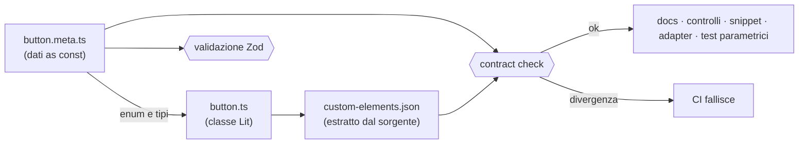

# Component Metadata Registry — Specifica

> Stato: proposta (M0). Implementazione dello schema in M2, prima definizione reale in M3 (Button).
> Gli esempi di codice in questo documento sono illustrativi del contratto, non implementazione.

## 1. Obiettivi

1. Un'unica descrizione del **contratto pubblico** di ogni componente.
2. Generazione automatica di: controlli del configuratore, documentazione API, tabelle delle proprietà, esempi, snippet di codice, configurazioni di test, voci di catalogo, adapter per framework.
3. Verificabilità: i metadata non possono divergere dall'implementazione senza che la CI fallisca.

Non-obiettivi: generare la logica interna dei componenti; descrivere dettagli implementativi privati.

## 2. Collocazione

| Elemento                                                              | Posizione                                                               |
| --------------------------------------------------------------------- | ----------------------------------------------------------------------- |
| Schema Zod, tipi, validatore, API del registry, JSON Schema esportato | `@uds/metadata`                                                         |
| Definizione del componente                                            | `packages/components/src/<nome>/<nome>.meta.ts`                         |
| Registry aggregato dei componenti                                     | `@uds/components/metadata` (subpath di soli dati, nessun import di Lit) |

## 3. Flusso e verifica



Il contract check confronta: nomi delle proprietà, attributi riflessi, tipi (normalizzati), default, eventi, slot, CSS parts, CSS custom properties. Un elemento presente da un solo lato è un errore.

## 4. Schema (bozza)

```ts
type ComponentMetadata = {
  schemaVersion: 1;
  id: string; // 'button' — stabile, kebab-case
  tagName: `uds-${string}`; // 'uds-button'
  name: string; // 'Button'
  description: string;
  category: 'actions' | 'forms' | 'navigation' | 'feedback' | 'layout' | 'data-display' | 'overlay';
  status: 'experimental' | 'beta' | 'stable' | 'deprecated';
  since: string; // versione di introduzione
  properties: PropertyMeta[];
  events: EventMeta[];
  slots: SlotMeta[];
  cssParts: CssPartMeta[];
  cssProperties: CssCustomPropertyMeta[];
  states: StateMeta[]; // hover, focus-visible, active, disabled, loading…
  constraints: ConstraintMeta[]; // regole tra proprietà
  examples: ExampleMeta[];
  accessibility: AccessibilityMeta;
  responsive: ResponsiveMeta;
  codegen?: CodegenMeta;
};

type PropertyMeta = {
  name: string; // nome della proprietà JS (camelCase)
  attribute?: string | false; // attributo HTML (kebab-case) o false se solo proprietà
  reflect?: boolean;
  description: string;
  type:
    | { kind: 'string' }
    | { kind: 'number'; min?: number; max?: number; step?: number }
    | { kind: 'boolean' }
    | { kind: 'enum'; values: readonly string[] }
    | { kind: 'icon' } // riferimento a una voce dell'Icon Registry
    | { kind: 'object'; schemaRef: string }; // solo proprietà, mai attributo
  default?: unknown;
  required?: boolean;
  deprecated?: { since: string; replacement?: string; removalIn: string; reason: string };
  control?: {
    kind: 'select' | 'radio' | 'toggle' | 'text' | 'number' | 'icon-picker';
    group?: string;
  };
  since?: string;
};

type EventMeta = {
  name: string; // 'uds-change'
  description: string;
  detail?: { schemaRef: string } | null;
  cancelable?: boolean;
  frameworkNames?: { react?: string; angular?: string; vue?: string }; // derivati se assenti
};

type SlotMeta = { name: string /* '' = default */; description: string; allowedContent?: string };
type CssPartMeta = { name: string; description: string; stability: 'stable' | 'experimental' };
type CssCustomPropertyMeta = {
  name: `--uds-${string}`;
  description: string;
  token?: string;
  syntax?: string;
};

type ConstraintMeta =
  | { kind: 'requires'; when: Condition; then: Condition; message: string }
  | { kind: 'forbids'; when: Condition; then: Condition; message: string };
// es. "se iconOnly allora ariaLabel è obbligatorio"

type AccessibilityMeta = {
  role: string; // ruolo nativo risultante
  keyboard: { keys: string; action: string }[];
  requirements: {
    id: string;
    wcag: string[];
    description: string;
    verification: 'automated' | 'manual' | 'both';
  }[];
  knownLimitations: string[];
};

type ResponsiveMeta = { behavior: string; containerQueries?: boolean; notes?: string[] };

type ExampleMeta = { id: string; title: string; description?: string; config: ComponentConfig };

type CodegenMeta = {
  imports?: Partial<Record<'html' | 'react' | 'angular' | 'vue', string[]>>;
  omitDefaults?: boolean; // default true
};
```

`ComponentConfig` (input di code generator, playground, builder ed esempi):

```ts
type ComponentConfig = {
  component: string; // id del componente
  props?: Record<string, unknown>;
  cssProperties?: Record<`--uds-${string}`, string>;
  slots?: Record<string, Array<ComponentConfig | { text: string }>>;
  events?: string[]; // eventi da collegare a handler segnaposto negli snippet
};
```

## 5. Regole di validazione

- `id` e `tagName` univoci nel registry.
- `default` coerente con `type` (es. appartiene a `values` per gli enum).
- Proprietà di tipo `object` non possono avere `attribute`.
- Ogni proprietà deprecata ha `removalIn` maggiore della versione corrente (major successiva secondo la deprecation policy).
- Gli esempi (`examples[].config`) devono superare la validazione derivata dalle proprietà e dai vincoli.
- Le CSS custom properties devono riferire token esistenti quando `token` è valorizzato.
- `accessibility.requirements` non può essere vuoto per componenti `stable`.

## 6. Consumatori

| Consumatore      | Uso                                                                         |
| ---------------- | --------------------------------------------------------------------------- |
| Componente Lit   | Importa enum/tipi (`ButtonVariant` derivato da `values`)                    |
| Adapter generati | Nomi di proprietà, eventi e tipi per React/Angular/Vue                      |
| Code generator   | Serializzazione idiomatica per target; omissione dei default                |
| Portale          | Catalogo, dettaglio, tabelle API, controlli del playground                  |
| Storybook        | `argTypes` derivati                                                         |
| Test             | Test parametrici su varianti × dimensioni × stati; validazione degli esempi |
| CLI              | `list`, `add`                                                               |

## 7. Versionamento dello schema

`schemaVersion` permette migrazioni. Modifiche incompatibili allo schema richiedono un nuovo valore di `schemaVersion` e uno script di migrazione in `tools/scripts`.
