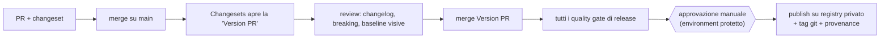

# Versionamento e governance

## 1. Semantic Versioning applicato al design system

| Modifica                                                                                                      | Tipo                                                           |
| ------------------------------------------------------------------------------------------------------------- | -------------------------------------------------------------- |
| Nuovo componente, nuova proprietà opzionale, nuovo evento, nuovo slot, nuova CSS custom property, nuovo token | minor                                                          |
| Bug fix senza cambio di contratto                                                                             | patch                                                          |
| Modifica del valore di un token semantico o di componente (impatto visivo)                                    | minor, con nota "visual change" e baseline approvate           |
| Modifica del valore di un token primitivo                                                                     | minor se gli alias mantengono il significato; altrimenti major |
| Rinomina o rimozione di proprietà, attributo, evento, slot, CSS part, CSS custom property, token              | **major**                                                      |
| Cambio del default di una proprietà con impatto visivo o comportamentale                                      | **major**                                                      |
| Cambio della struttura interna che rompe CSS parts dichiarati `stable`                                        | **major**                                                      |
| Modifica di CSS parts `experimental`                                                                          | minor                                                          |

Durante la serie `0.x` le modifiche incompatibili sono ammesse in minor, ma vanno comunque marcate come breaking nei changeset.

## 2. Deprecation policy

1. Deprecazione in una minor: metadata aggiornati (`deprecated`), warning in console solo in sviluppo, documentazione con la migrazione.
2. Permanenza per almeno una minor e 90 giorni.
3. Rimozione solo nella major successiva, con guida di migrazione e, dove possibile, codemod.

## 3. Changesets

- Ogni PR che modifica un package pubblicato include un changeset.
- Gruppo `fixed`: `@uds/tokens`, `@uds/themes`, `@uds/core`, `@uds/icons`, `@uds/metadata`, `@uds/components`, `@uds/react`, `@uds/angular`, `@uds/vue`.
- Indipendenti: `@uds/code-generator`, `@uds/theme-tools`, `@uds/builder-engine`, `@uds/cli`.
- Changelog generato per package e aggregato nel portale (sezioni: breaking, deprecazioni, nuove funzionalità, correzioni, modifiche visive).

## 4. Pipeline di release

- Nessuna pubblicazione da macchine locali; token di pubblicazione solo nell'environment protetto.
- Prerelease (`next`, `beta`) con la modalità pre di Changesets.

## 5. Rollback

- Mai `npm unpublish` di versioni consumate.
- Rollback immediato: spostare il dist-tag `latest` sulla versione precedente e `npm deprecate` della versione difettosa con messaggio.
- Correzione definitiva: patch successiva ("roll forward").
- I CSS dei temi distribuiti via CDN interno sono versionati nel percorso; il rollback consiste nel ripuntare la versione.

## 6. Regole di governance

| Attività                                  | Requisiti                                                                                                                    |
| ----------------------------------------- | ---------------------------------------------------------------------------------------------------------------------------- |
| Aggiunta componente                       | Proposta (RFC breve in `docs/decisions/` o issue), metadata, checklist a11y, design approvato, stato iniziale `experimental` |
| Modifica API                              | Valutazione d'impatto nella PR, changeset con tipo corretto, aggiornamento metadata (il contract check lo impone)            |
| Rimozione proprietà                       | Solo dopo deprecazione secondo §2                                                                                            |
| Modifica token                            | Report di diff dei token + regressione visiva; per i token semantici approvazione del design owner                           |
| Modifica temi                             | Test di contrasto verdi + regressione visiva su tutti i temi                                                                 |
| Promozione `experimental → beta → stable` | Definition of Done completa e checklist a11y manuale                                                                         |

Ogni regressione visiva va approvata esplicitamente in review: nessun aggiornamento automatico delle baseline.
